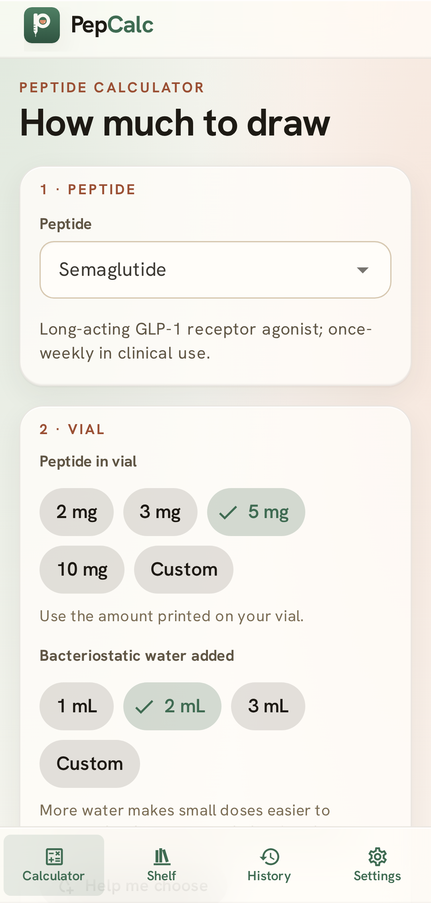
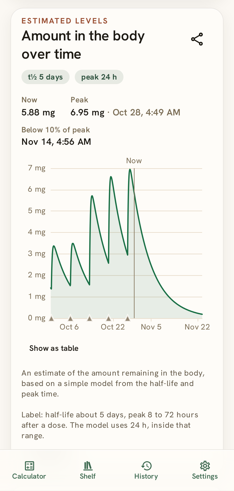

# PepCalc

A private, offline peptide reconstitution and draw calculator for researchers. Install it
from the browser to your phone or tablet's home screen; it then works with no connection.
Everything you enter stays on your device.

<p align="center">
  
  &nbsp;&nbsp;
  
</p>

Pick a peptide, the amount in your vial and the water you added, and PepCalc shows how far to
draw the syringe, with a drawing of the barrel to check against. It runs on your device with no
account, server or tracking.

> PepCalc does arithmetic and shows sourced reference values. It does not recommend doses and
> is not medical advice. Several listed peptides are investigational or not approved for human
> use.

## Features

- Draw calculator: dose in mg, mcg or IU, with the volume and syringe reading for U-100 (1,
  0.5, 0.3 mL, half-unit), U-40 and mL syringes. Warns when a draw is over capacity, under one
  mark or between marks.
- Mixing advisor: enter the doses you plan to draw and your vial size, and PepCalc ranks water
  volumes so every dose fits one syringe and lands on a mark. For peptides users report as
  stinging (GHK-Cu and blends that contain it), it dilutes as far as the vial allows, or says how
  far to top up the syringe with water.
- Presets with sources: vial sizes, water volumes and doses for each peptide, each marked as
  coming from a prescribing label, a clinical trial or community reports.
- Blends: KLOW, GLOW and custom mixes split each dose into its components.
- Shelf: save mixed vials, log draws and see what's left.
- Level charts: an estimate of the amount remaining in the body, based on a simple model from
  published human data (semaglutide, tirzepatide, retatrutide, cagrilintide, tesamorelin). For
  other peptides you can enter your own half-life, and the chart is marked user-supplied.
- Share and export: share a level chart as an image, with or without the peptide name and
  amounts, or export a PDF report for the last 30 days, 90 days or all time. Both are made on
  the device.
- Private and offline: no account, server, analytics or third-party requests. Back up to a JSON
  file you keep.
- Phones and tablets, in light and dark themes.

## Launch peptides

Semaglutide, Tirzepatide, Retatrutide, Cagrilintide, Tesamorelin, BPC-157, TB-500, GHK-Cu, KPV,
GLOW, and KLOW. Adding more is a data change: see [docs/adding-a-peptide.md](docs/adding-a-peptide.md).

## How the numbers work

- Concentration = amount in vial / water added.
- Volume to draw = dose / concentration.
- Syringe reading = volume x units per mL (100 for U-100, 40 for U-40), or mL directly.
- Mixing advisor: tries water in 0.5 mL steps up to 10 mL, keeps volumes where the largest
  dose fits one syringe and the smallest is at least one mark, then ranks by fitting the vial,
  meeting any comfort cap (mg/mL), landing on marks, and most water.
- Level chart: a one-compartment model with first-order absorption and elimination, fitted to
  the published half-life and time to peak and summed over doses. It estimates drug remaining
  in the body, not blood concentration.

## Installing on a device

Settings shows the steps for the browser you are using, with a screenshot.

| Device                  | Steps                                                     |
| ----------------------- | --------------------------------------------------------- |
| Android, Chrome or Edge | Menu, Install and create shortcut (or Add to Home screen) |
| Android, Firefox        | Menu, Add app to Home screen                              |
| iPhone or iPad, Safari  | Share, Add to Home Screen                                 |
| iPhone or iPad, Chrome  | Share (in the address bar), Add to Home Screen            |

On iPhone and iPad, Safari and the installed app keep separate data; use a backup to move it.
Make regular backups (Settings): browsers can clear site data under storage pressure.

## Development

Requires Node 24 (see `.nvmrc`).

```bash
nvm use
make install
make dev          # http://localhost:5173/pepcalc/
make check        # fast gate
make check-all    # full gate, including offline e2e tests
```

Project conventions for contributors and coding agents are in [CLAUDE.md](CLAUDE.md) and
`.claude/skills/`.

## Deploying to GitHub Pages

1. Push the repository to GitHub.
2. In the repository settings, under Pages, set the source to **GitHub Actions**.
3. Push to `main`. `.github/workflows/deploy.yml` runs the gate, builds with the repository
   name as the base path (`https://<owner>.github.io/<repo>/`), and publishes.

For a custom domain or a user site served from the root, set the repository variable
`PEPCALC_BASE` to `/`. Locally, `PEPCALC_BASE=/ npm run build` does the same.

## Android app

The Android app is a [Capacitor](https://capacitorjs.com) shell around the same web build,
bundled into the APK so it works offline from first launch. It requests no network permission;
CI fails if the merged manifest ever asks for one. Cloud backup is off, so data leaves the
device only as a backup file the user exports.

```bash
make android      # build dist-android/ and sync it into android/
cd android && ./gradlew assembleDebug    # needs JDK 21 and the Android SDK
```

`.github/workflows/android.yml` builds a debug APK on every push and uploads it as a workflow
artifact. A release build is signed when `PEPCALC_KEYSTORE`, `PEPCALC_KEYSTORE_PASSWORD`,
`PEPCALC_KEY_ALIAS` and `PEPCALC_KEY_PASSWORD` are set; keep the keystore out of the
repository and backed up, because a lost key means the app can never be updated. The version
comes from `package.json` (`versionCode` is `major * 10000 + minor * 100 + patch`).

The app id `io.github.pepcalc`, and the WebView origin `https://localhost` that holds the
app's IndexedDB, must never change after release. Data in the browser-installed PWA does not
carry over to the Android app (and vice versa); move it with a backup file.

`npm run icons:android` regenerates the launcher icons from `public/favicon.svg`.
